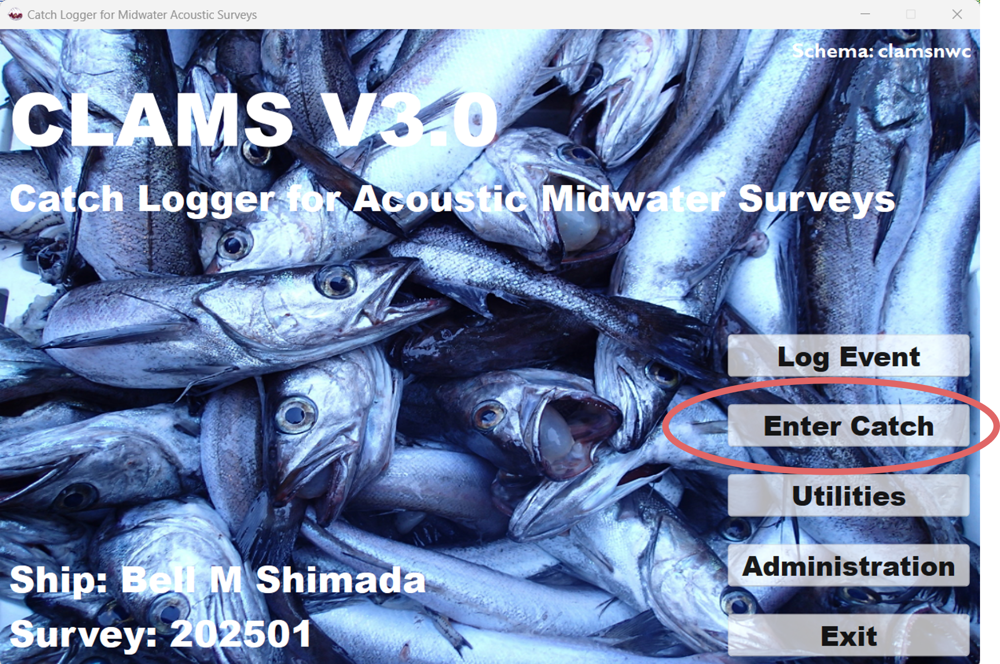
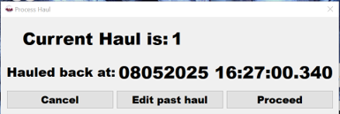
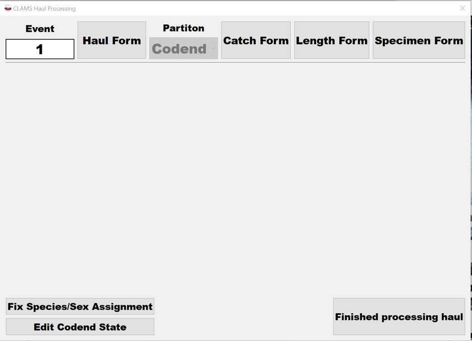
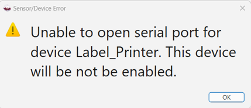
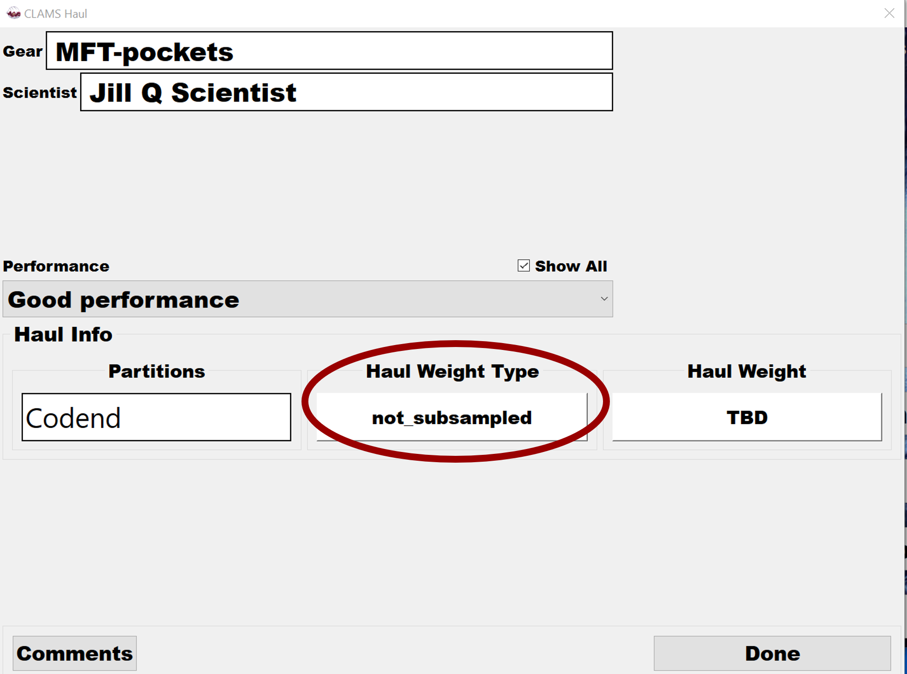
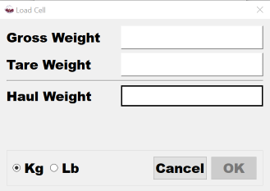
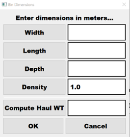
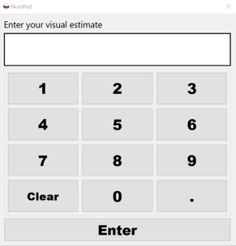
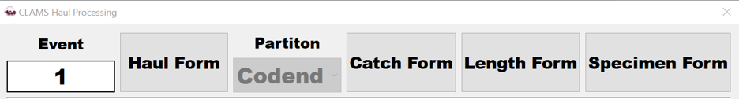
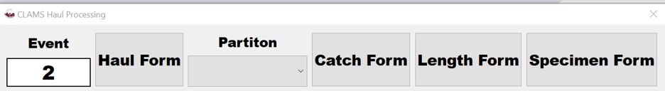

::: {.list-table header-rows=0 aligns="l,c" tbl-colwidths="[50,50]" .table-striped}

- - To enter the catch for an operation, click **‘Enter Catch’.** A prompt will appear to acknowledge which tow is set and the current haul in the database. Press **‘Proceed’** to continue if the number displayed is correct, or you can click **‘Edit past haul’** to change the current haul to a previous one.

    **_Pay attention here!_** Because there are pocket nets involved, the setting allows for information to be entered before the tow is ‘Done’ in the wheelhouse. Pay attention to the time to make sure you are entering the information into the correct haul.

  - {style="width: 90%;"}

    

- - You will be asked to identify yourself before the program goes through the devices that are set in the database for the station and makes sure they can be reached.
  - 

- - **_NOTE_**: Due to a lack of time and resources, the printer functions for the Integrated Survey were not merged into the printer functions used by the AFSC. This results in a warning that it cannot find the Label_Printer for the station, shown below. Hopefully this will be corrected soon, but in the meantime it is safe to ignore and click ‘OK’ to continue.
  - 
:::

## Haul Form

::: {.list-table header-rows=0 aligns="l,c" tbl-colwidths="[50,50]" .table-striped}

- - Click on the Haul Form first to set the Haul Weight Type. Most of the time, a codend will be weighed in its entirety, so it will not be subsampled.

    You are also able to enter an overall comment for the haul in general here by clicking on Comments at the bottom of the form. If someone entered a comment while logging the event, it will show up here so make sure you do not delete or overwrite their comments!!
  - {style="width: 90%;"}
- - To enter a load cell weight:
  - 
- - Calculate the bin volumetric weight:
  - 
- - Enter an educated guess for the weight:
  - 

:::

## Choosing a Partition

#### Non-Pocket Example

Since there are no ‘partitions’ other than the codend, the Partition dropdown defaults to Codend and is greyed out. There is nothing to do here as it automatically selects the codend as the partition.

#### Pocket Example

In this case, a partition must be chosen FIRST using the dropdown to continue and place the information into the correct partition of the net (codend, pocket 01, etc).

## Catch Form

::: {.list-table header-rows=0 aligns="l,c" tbl-colwidths="[50,50]" .table-striped}

:::