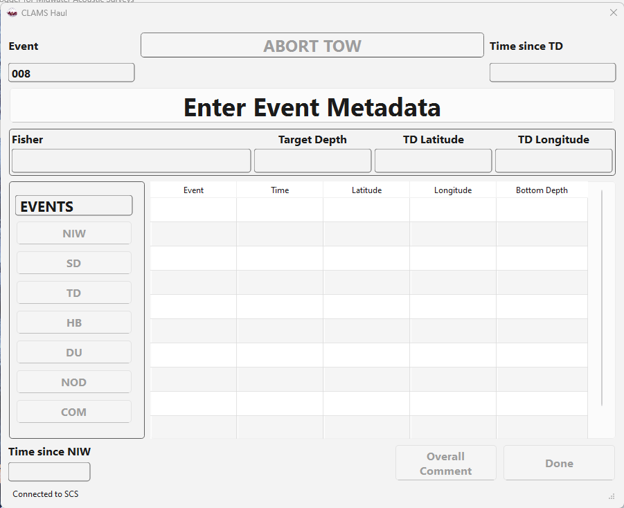
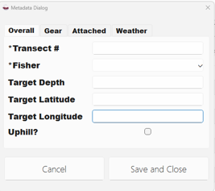
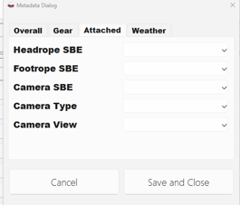
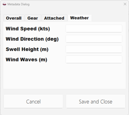

## Getting Started :dizzy:

::: {.list-table header-rows=0 aligns="l,c" tbl-colwidths="[50,50]" .table-striped}

- - Click **‘Log Event’** to start the process of taking data for the events during a tow
    
    Choose which type of event to log (“Trawl Event” is the only one for 2025) 

  - {style="width: 90%;"}

- - Another dialog will pop up where you can see a past tow, continue on a tow that is not finished (like if the computer crashes or something), or start a new event.
  - {style="width: 60%;"}
::: 

## Starting a New Event :heavy_plus_sign:

::: {.list-table header-rows=0 aligns="l,c" tbl-colwidths="[50,50]" .table-striped}

- - Click **‘Start New Event’** to proceed to the trawl form. Nothing is enabled at this point until required metadata is entered. **If you close out of this before entering any metadata, the event will not be created in the database.**
  - {style="width: 80%;"}
  
- - Things to look for:
     1. Event number is correct in the **upper left corner**
     2. SCS is connected and message is in **lower left corner**

  - {style="width: 50%;"}

    {style="width: 50%;"}

:::

## Entering Metadata :outbox_tray:

::: {.list-table header-rows=0 aligns="l,c" tbl-colwidths="[50,50]" .table-striped}

- - Click the **‘Enter Event Metadata’** button at the top. 
    
    NOTES: 

    A pop-up will appear to remind you to turn off the EAL and reset the recording depth
    You can return to this screen at any time to enter new data or modify existing data. **ONLY THE REQUIRED FIELDS ARE NECESSARY TO START A TRAWL**
    
    Any measure on **ANY** tab that has an asterisk (*) next to it is a required field to enter before any of the event buttons are enabled. 
    
    When you click on a field, the appropriate entry method will pop up. For example, when pressing **'Transect #'**, a number pad will appear.

  - {style="width: 80%;"}

:::

:::{.panel-tabset} 

### Overall Tab

::: {.list-table header-rows=0 aligns="l,c" tbl-colwidths="[50,50]" .table-striped}

- - For 2025, the required fields on this tab are the transect number and the fisher.
    
    Target Depth is the depth that you are targeting in the school, and the target latitude and longitude are where in the school you would like to be at that target depth. 

    The Uphill checkbox is used if the tow is going ‘uphill’. This way we can flag if we need to use some other means to calculate the average bottom depth, since the depth is from the ship instead of the net. One such method would be to use the depths entered into the trawl mensuration form when using the depth under the net on the FS70.
  - {style="width: 80%;"}

:::

### Gear Tab

::: {.list-table header-rows=0 aligns="l,c" tbl-colwidths="[50,50]" .table-striped}

- - The only required field on this tab is the Gear. For 2025 we will use **_MFT_** for tow where the pockets remain open and **_MFT-pockets_**  for a tow where the pockets are closed.

    The Tom weights is a field to designate how much weight was used on one side. The net number is a designation for which net is being used.
  - {style="width: 80%;"}

:::

### Attached Tab

::: {.list-table header-rows=0 aligns="l,c" tbl-colwidths="[50,50]" .table-striped}

- - The dropdowns in the tab are for the peripheral devices like the TDRs and camera. Unless there is something wrong with one of the TDRs, the convention is for the headrope to have the red, the footrope to have the blue, and the camera to have the white.
  - {style="width: 80%;"}

:::

### Weather Tab

::: {.list-table header-rows=0 aligns="l,c" tbl-colwidths="[50,50]" .table-striped}

- - This tab is for data about the weather. If you don’t know where this information can be found, ask an officer in the wheelhouse and they will point you to where this is displayed.
  - {style="width: 80%;"}

:::

:::