## Getting Started :dizzy:

::: {.list-table header-rows=0 aligns="l,c" tbl-colwidths="[50,50]" .table-striped}

- - Click **‘Log Event’** to start the process of taking data for the events during a tow
    
    Choose which type of event to log (“Trawl Event” is the only one for 2025) 

  - 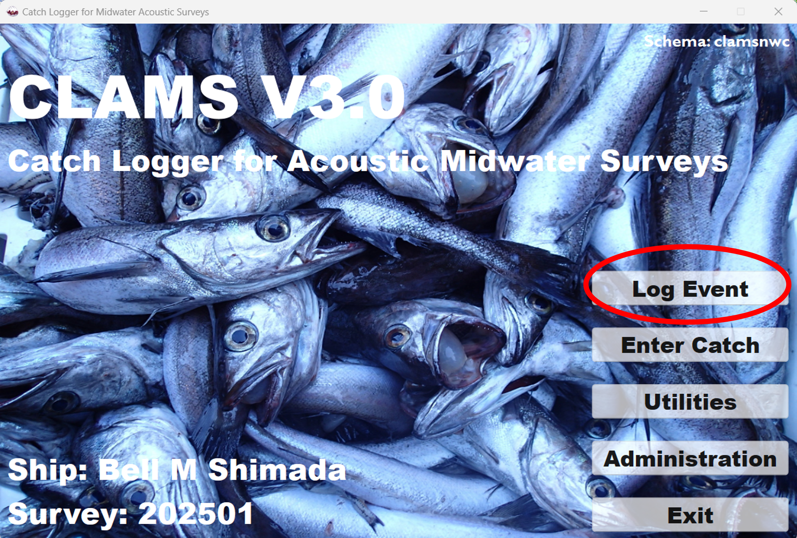{style="width: 90%;"}

- - Another dialog will pop up where you can see a past tow, continue on a tow that is not finished (like if the computer crashes or something), or start a new event.
  - 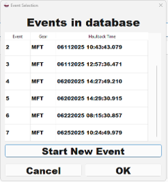{style="width: 60%;"}
::: 

## Starting a New Event :heavy_plus_sign:

::: {.list-table header-rows=0 aligns="l,c" tbl-colwidths="[50,50]" .table-striped}

- - Click **‘Start New Event’** to proceed to the trawl form. Nothing is enabled at this point until required metadata is entered. **If you close out of this before entering any metadata, the event will not be created in the database.**
  - {style="width: 80%;"}
  
- - Things to look for:
     1. Event number is correct in the **upper left corner**
     2. SCS is connected and message is in **lower left corner**

  - 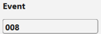{style="width: 50%;"}

    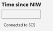{style="width: 50%;"}

:::

## Entering Metadata :outbox_tray:

::: {.list-table header-rows=0 aligns="l,c" tbl-colwidths="[50,50]" .table-striped}

- - Click the **‘Enter Event Metadata’** button at the top. 
    
    NOTES: 

    A pop-up will appear to remind you to turn off the EAL and reset the recording depth
    You can return to this screen at any time to enter new data or modify existing data. **ONLY THE REQUIRED FIELDS ARE NECESSARY TO START A TRAWL**
    
    Any measure on **ANY** tab that has an asterisk (*) next to it is a required field to enter before any of the event buttons are enabled. 
    
    When you click on a field, the appropriate entry method will pop up. For example, when pressing **'Transect #'**, a number pad will appear.

  - {style="width: 80%;"}

:::

:::{.panel-tabset} 

### Overall Tab

::: {.list-table header-rows=0 aligns="l,c" tbl-colwidths="[50,50]" .table-striped}

- - For 2025, the required fields on this tab are the transect number and the fisher.
    
    Target Depth is the depth that you are targeting in the school, and the target latitude and longitude are where in the school you would like to be at that target depth. 

    The Uphill checkbox is used if the tow is going ‘uphill’. This way we can flag if we need to use some other means to calculate the average bottom depth, since the depth is from the ship instead of the net. One such method would be to use the depths entered into the trawl mensuration form when using the depth under the net on the FS70.
  - {style="width: 80%;"}

:::

### Gear Tab

::: {.list-table header-rows=0 aligns="l,c" tbl-colwidths="[50,50]" .table-striped}

- - The only required field on this tab is the Gear. For 2025 we will use **_MFT_** for tow where the pockets remain open and **_MFT-pockets_**  for a tow where the pockets are closed.

    The Tom weights is a field to designate how much weight was used on one side. The net number is a designation for which net is being used.
  - 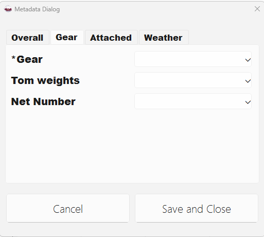{style="width: 80%;"}

:::

### Attached Tab

::: {.list-table header-rows=0 aligns="l,c" tbl-colwidths="[50,50]" .table-striped}

- - The dropdowns in the tab are for the peripheral devices like the TDRs and camera. Unless there is something wrong with one of the TDRs, the convention is for the headrope to have the red, the footrope to have the blue, and the camera to have the white.
  - {style="width: 80%;"}

:::

### Weather Tab

::: {.list-table header-rows=0 aligns="l,c" tbl-colwidths="[50,50]" .table-striped}

- - This tab is for data about the weather. If you don’t know where this information can be found, ask an officer in the wheelhouse and they will point you to where this is displayed.
  - {style="width: 80%;"}

:::

:::

#### Save and Close

Once the required metadata is entered and saved using the Save and Close button, the event is created in the database using the event number in the upper left corner. The NIW button is now enabled and you can start entering any overall comments for the tow. You can also add any preliminary COMs, although this will pop up the net mensuration dialog (more on this later). Also, if you enter a COM before NIW is pressed, the SCS data will not be recorded for that button press.

## Entering Trawl Events :pencil2:

::: {.list-table header-rows=0 aligns="l,c" tbl-colwidths="[50,50]" .table-striped}

- - **Definitions**

    NIW: Net In Water (net has touched the water)

    SD: Shoot Doors (doors are released)

    TD: Target Depth

    HB: Haul Back

    COM: Comment/Notes

    DU: Doors Up (doors secured to the trawl frame)

    NOD: Net on Deck (net is completely on deck)
  - 

- - To start a tow, and to start recording the incoming SCS stream, NIW must be clicked. Once clicked, the tow can be aborted and a timer starts in the lower left corner to keep track of the time since the net went into the water.
    
    Notes:
    * Prior to NIW and after metadata has been entered, the event form can be closed and opened again for another event, but the fisher should check and update the metadata if things change.
    * Even though the values for latitude, longitude, and bottom depth do not show up in the form for NIW, it is being recorded as long as SCS is connected.
    * When you click TD, a timer will start in the upper right corner that will show the time since TD was pressed. When you click HB, that timer will stop.
    * Once HB is clicked, you can no longer abort the tow. THIS IS DIFFERENT! If a tow is to be aborted, you must use the ABORT TOW button BEFORE you hit HB.
    * When you enter a COM, it will put a number after it. This is because the database currently needs to have unique names for each trawl for the event data. Right now, you can enter 15 COMs only, so use them wisely.

  - 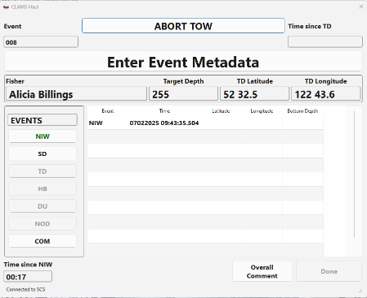{style="width: 90%;"}

    Once NIW is pressed (as in the image above), the ABORT TOW button is now active, and the SD button can be pressed. **_The buttons must be pressed in order!_** However, if you accidentally press a button before it’s time, you are able to press it again to update the time for that button press. BUT, there is no logic that will KEEP the buttons in order if you overwrite, so please be careful with this.

- - **Net Mensuration Dialog**

    When you press TD, HB, or COM, a net mensuration dialog will appear to enter values, although none of them are required in the software. While an entry is not required, it is best practice to include at least measures for TD and HB.

    Again, when you press the button next to each field name, a popup will appear to enter the values. You can also use the keyboard.

    When the record is complete, **you MUST click ‘Add Record’ to complete the entry in the database.**

    If you make a mistake or want to see the entered values, click on the record in the main trawl form and the dialog will pop up again.

  - 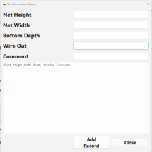{style="width: 70%;"}

:::

## Finishing a Tow :heavy_check_mark:

::: {.list-table header-rows=0 aligns="l,c" tbl-colwidths="[50,50]" .table-striped}

- - After NOD is pressed, the event is considered done and all of the event buttons are disabled. However, **_you will still need to press the Done button to finalize the tow._** This will create averages of the SCS sensors (and eventually the weighted averages of the net mensuration entries) in the Event_Data table.
    
    NOTES:

    * Because we may be processing pocket nets prior to NOD, the computers in the wet lab will be able to start processing catch before the tow is complete.
    
    Use the dropdown to change the gear performance if there were any issues and the comment box if you wish to add any comments. If you think there is a reason to use the manually entered bottom depths instead of the ones provided by SCS, make sure to check the checkbox.

    When you click ‘Done’ from this dialog, the tow will be complete.
   - 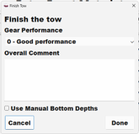{style="width: 70%;"}

:::

## Aborting a Tow

::: {.list-table header-rows=0 aligns="l,c" tbl-colwidths="[50,50]" .table-striped}

- - Once NIW is pressed, the ABORT TOW button is enabled. This button should be pressed if the tow is stopped before it should be due to an issue (marine mammals, gear issues, etc).

    Both fields are REQUIRED to abort a tow. Once a tow is aborted, it will show **_‘Aborted Operation’_** in the haulback time field showing the events in the database
  - 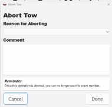{style="width: 70%;"}
:::

## Starting a Previous Event

::: {.list-table header-rows=0 aligns="l,c" tbl-colwidths="[50,50]" .table-striped}

- - If the program crashes or needs to be restarted before a tow is completed, you will need to select the event you were working on to continue. In the Event Selection dialog box, a tow that has not reached haulback will be colored in red.
  - 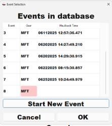{style="width: 70%;"}
- - If you get into an event that is not finished, you will see the following dialog

    If you get into an event that IS finished (NOD has been pressed), you can still look at it and modify, but you cannot add anything new and SCS will no longer be recording.
  - 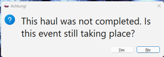{style="width: 70%;"}

:::