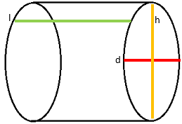
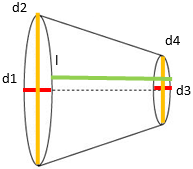
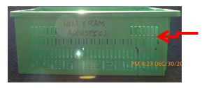

::: {.callout-note icon=false title ="Additional Resources"}

A single-sheet checklist for the current cruise of the duties required to prepare for and process a tow is in the lab materials available in the wet lab.

:::

## Marine Mammal Watch

A marine mammal watch is required before every trawl activity. See Chief Scientist for current protocols.

## Prepare Peripheral Devices

Most tows will have at least one NWFSC/FRAM sensor attached. Each sensor has a short one-sheeter of specifics for how to run the sensor. The same goes for any other attached devices such as cameras or light meters.

## Fish Sampling Protocols -- Best Practices

::: {.callout-important title ="IMPORTANT"}

***ALL FISH IN THE CODEND ARE CONSIDERED IN THE SAMPLE – DO NOT PICK FROM INTERMEDIATE***

:::

::: {.panel-tabset}

### Total Catch Subsampling 

Preferred Order of Determining Catch:

1. Whole-haul/Table
2. Guesstimate
3. Volumetric

::: {.panel-tabset}
### Whole-haul
***Whole-haul: Everything can be weighed***

If you have a catch larger than the hopper, you may be able to do multiple dumps into the hopper to process. If the catch is relatively clean, the bycatch can be pulled off for the entire catch (like whole-haul sampling). If the catch is not clean, treat the entire catch as a mix. While everything is run through the wet lab, only one hopper dump is randomly chosen to sort to species and use for biosampling.

### Guesstimate

***Guesstimate: Use your experience to estimate the weight of the entire catch***

Another way to deal with a large catch is to use your experience to estimate the total weight of a catch. You can use a variety of methods to increase the accuracy of your estimate. One that works well is to visually define sections of the catch, choose one section to weigh and sample from (randomly, of course), and extrapolate that weight to the total number of sections for a weight estimate.

### Volumetric

***Volumetirc: Measure the Codend***

The crane that is used to pick up the codend may not be able to lift it to do multiple hopper dumps. You can measure the codend and determine a density to get an estimated total weight of the catch. A full codend usually falls into one of two shapes: Cylinder or Frustum. Once the codend is measured, visually divide it into equal portions and randomly select at least one to sort and weigh everything. Use this portion to take all biological samples.

::: {.list-table header-rows=0 tbl-colwidths="[50,50]" .table-striped}

- - For a codend shaped like a cylinder, you need to get the diameter across (d), the height (h), and the length of the codend (l).
  - {style="display: block; margin: 0 auto; width: 60%;"}

- - {style="display: block; margin: 0 auto; width: 60%;"}
  - For a codend shaped like a frustum, you need to get the diameters for the larger end (d1 and d2) and the smaller end (d3 and d4), as well as the length (l).

- - Determine the Density:

    - The density is a measure of how compact or spaced the fish are within the bin, measured as the mass divided by the volume.
    - To determine this, take a basket of the UNSORTED catch, filled up to the top of the last full row of vertical slats, and weigh it to at least a tenth of a kilogram on a calibrated scale.
    - Divide that weight by the volume of the basket using the following formula and enter the final number into the density box.
    
    | Density = Wt of basket (kg)/ 0.029638(m^3^)
  - {style="display: block; margin: 0 auto; width: 100%;"}
::: 

:::

### Collecting Specimens from Sorted Catch

Because of the relatively large number of otoliths and lengths involved from one species, they are normally sampled at two separate locations. The fishes used for length frequency are sampled at one station, while the otolith and special sampling fish are sampled at another. To do this in a timely fashion and still get a random sample, the otolith fish are a subsample taken from the randomly selected length fish.

### Basics -- Random vs. Haphazard

Gathering a random sample, whether it is to subsample the total catch or to gather fish for biosampling, is the most important priority. A random sample is a way of getting a representative portion of the population by ensuring that every organism in that population has a chance of getting into the sample. The probability can be determined in a sample gathered in this way. A frame must be set up beforehand and followed completely to the end. 

A haphazard sample, however, does not produce an accurate probability of an organism getting into the sample. Therefore, a representative sample is not guaranteed. A haphazard sample does not have a frame set up beforehand and is more of a ‘take it whenever’ type of gathering. This introduces unintentional bias by the ‘chooser’ and is not the protocol of the FEAT team.

Because over 99% of the time the catch ends up in a basket, a random systematic sampling frame is usually the easiest to create for tows that have more than the required number of fish for a full sample (check the Species Sampling Summary in the wet lab materials for current cruise protocol). After the number of baskets is determined to fulfill the amount of fish needed for a full sample, every nth basket is weighed, marked as a subsample, and set aside. All other baskets are weighed and thrown overboard. When all of the fish are processed and sorting is complete, a random sample of the baskets that were set aside is taken to get enough fish for the otolith samples.

### Specifics

**Determining baskets to keep for length and otolith samples**

Systematic random sampling is a method in which every nth unit is taken from a population starting from a randomly selected unit within the predetermined interval. The constant difference between each unit (the ‘nth’) is the interval. 

:::

### FEAT Sampling Term Definitions

**Population:** all of the fish in the codend

**Unit:** usually a basket, but in general is any way to slice the population into (roughly) equal parts 

**Interval:** the constant difference between units that will be a part of the sample

**Random Start:** a number between 1 and the interval, determined randomly by using a random number table or some other comparable method such as the second hand on a clock

#### Examples of Suggested Methods

:::{.panel-tabset} 

### General

1. Determine the sampling interval
    a) Make an educated guess of the number of total units in the population
    b) Determine a rough amount of fish per unit
    c) Determine how many units are needed to get fish for the sample
        i) Divide the number of fish needed by the number of fish per unit
    d) Determine the interval
        i) Divide the total number of units by the number of units needed
2. Determine a random start within the interval using a random number table, watch, or other means 
3. Determine which units to sample by taking every nth unit starting from the random start point 
4. Determine which unit to use for otolith fish 
5. Collect otolith fish randomly from the unit

### Specific

1. Determine the sampling interval
    a) An educated guess is made as to the total number of baskets in the codend (or the fish hopper). As experience is gained, this number will become more accurate. Until you feel comfortable doing it on your own, ask others or the survey tech to help you guess. When everyone is ready and the conveyor belt is running, the hopper gate is opened and a small amount of fish is let out at a time.
    b) To determine the amount of fish per unit, an easy way is to count the number of fish that fill up the first basket. The number will change dramatically as the size of the fish changes. After a while, you may not need to count to get a rough estimate of the number of fish per unit.
    c) The amount needed for a sample is outlined in a document specific to each season. To determine **how many baskets** (units) will be needed to get the sample, divide the total number needed by the number counted for the first basket.
    d) To determine **the interval**, divide the total number of baskets guessed in the first step by the number of baskets needed that was determined in the previous step.
2. Determine a random start
    a) Use a **random number table** (one is taped to a FSCS control box), the seconds on a clock (one is on the upper right-hand portion of the screen), or any other comparable method to select a number between 1 and the interval.
3. Determine the baskets to collect for the sample
    a) By adding the interval to the random start, the next sample basket is determined
    b) Continue in this manner until you reach the end of the total number of baskets
        i) You may end up with more baskets collected than you wanted. DO NOT stop when you reach the amount you need. Keep going until the catch is completely processed. You can pare the total baskets down by using a random number table to select the baskets you are going to keep (see sampling scenario).
4. Determine which basket(s) to get otolith fish from
    a) Sometimes the amount of fish in a basket is more than the number necessary for the species and sometimes it is less. If it is more, it will need to be randomly pared down. If it is less, more than one basket will need to be selected. 
    b) Use a random number table (one is taped near Station 1), the seconds on a clock, or any other comparable method, and select a number (or several numbers if more than one basket is needed) between 1 and the total number of collected subsample baskets.
5. Randomly select the otolith fish from the basket if there are too many
    a) Various methods are available, however using a ‘basket dump’ seems to be the easiest and the least time-consuming.
        i) A basket dump is when two baskets are placed long side by long side and the basket is poured over the top of the two to create two approximately equal samples. You can do this several times with multiple baskets to get down to the desired number of otoliths. 

:::

## TL;DR Summary

* Random sampling is the key 
* You must process everything that ends up in a random sample if you already start sampling!
  * You cannot pare down the sample size if you realize you gathered too many after you already started processing the samples. For example, if you get 55 instead of 50 fish to process otoliths, you MUST sample all 55 instead of stopping at the required 50. 
* Ask the FEAT team’s lead biologist if you need help determining how to gather random samples

## Sampling Scenario

For the cruise you are on, you are asked to collect 400 fish, of which 50 are for otoliths. A codend is dumped into the hopper and you estimate that it will take **28 baskets** to empty. You count the first basket and there are **100 hake**. Since you need about 4 baskets (400 needed/100 in a basket) to get your 400 fish, the **interval is 7** (28 estimated baskets/4 baskets for your sample). To determine the starting basket, you close your eyes and poke the random number table. The first number you pick is an 8, which is outside of the 1-7 range you need. Going again, you end up with a 5. 

As you fill up the baskets, you record the weight and dump overboard until you get to the 5th basket. This basket is weighed, marked as a measure basket, and set aside. The weights of the next 6 baskets are recorded and the contents dumped. The 7th basket (12th basket overall) is again weighed, marked as a subsample, and set aside. Keep the baskets in order in case you need to dump any! It’s much easier to determine which basket is which in CLAMS if you do this, and you will need to know this to change it from a measure basket to a toss basket.

Continuing this way, you pass your original estimate of 28 total baskets. When you get to basket 33, you must take it as a subsample, even though you now have more baskets than you need. Basket number 40 comes and again, you must take it as a subsample. The hake catch is finally over at basket number 43. 

You now have a total of 6 baskets when you only need 4. You can select either the baskets you are going to keep or the baskets you are going to discard. Either way, you will need to assign a number to each basket (1 to 6). Since you need to get rid of 2, it’s easier to select the ones to discard in this situation. Once they are numbered, use a random number table to choose 2 numbers between 1 and 6. You choose a 3 and a 6. To discard these baskets, you must make sure that you change it from a measure basket to the toss basket in CLAMS. **_This is extremely important!_** If you do not do this, the averages will be thrown off for the entire haul and the data may need to be thrown out! Since you choose 3 and 6 to discard, find those baskets in CLAMS and change the basket type for them from Measure to Toss.

Now that you have your overall sample, you will need to choose 1 basket for the otolith fish. Again, number the remaining baskets (1 to 4). Use the random number table to select a number between 1 and 4. Grab the corresponding basket. Remember, however, that there are 100 fish in this basket while we only need 50. To pare it down randomly, you use a method called a ‘basket dump’. First, you line up two empty baskets next to each other longwise. Take the selected basket, line it up so the middle is directly in line with where the two empty baskets meet, and dump. The left basket is now 1 and right is now 2. Go to the random number table again, designating all odd numbers as a sign for basket 1 and even for basket 2. You choose a 6 so basket 2 (good old righty) is now your otolith fish.

You may end up with more or less than 50 in this otolith basket. Regardless, these are your sample fish and you cannot add more or take out some to get it to exactly 50. 
